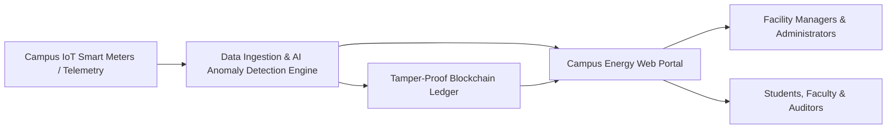

# 🌿 Campus Energy Monitor: Decentralized Energy Tracking & Anomaly Detection

## 1. Executive Summary
University and college campuses operate like micro-cities, consuming massive quantities of electrical energy across academic departments, research laboratories, residential hostels, sports complexes, and administrative facilities. However, modern educational institutions face a dual challenge: **rampant undetected energy waste** and a **lack of verifiable, tamper-resistant consumption records**.

This project introduces a **Smart Campus Energy Monitoring Platform** coupled with **Blockchain Technology**. The system provides real-time visibility into campus energy consumption, leverages automated anomaly detection to spot unusual electricity spikes or idle loads, and commits cryptographic proofs and consumption metrics to an immutable digital ledger. This ensures 100% transparency, verifiable green audits, and automated conservation incentives.

---

## 2. Problem Breakdown

### 2.1 Rampant Energy Waste & Inefficiencies
* **Unmonitored After-Hours Loads:** Classrooms, lecture halls, and offices frequently keep high-powered HVAC systems, projectors, and lighting running overnight or through weekends.
* **Faulty & Degrading Equipment:** Failing HVAC compressors, malfunctioning refrigeration units in dining halls, and uncalibrated lab equipment consume 30%–60% more power than normal before failure is physically noticed.
* **Phantom/Vampire Loads:** Dormitories and computer laboratories draw significant baseline power even when idle.
* **Delayed Response Times:** Traditional manual meter logging or monthly aggregate utility bills mean anomalies are detected weeks after financial and environmental damage has already occurred.

### 2.2 The Trust, Transparency & Audit Deficit
* **Data Tampering & Manipulation Risk:** Centralized databases are vulnerable to internal manipulation, accidental record loss, or deliberate altering of energy figures to present artificial carbon reduction numbers ("greenwashing").
* **Inter-Departmental Disputes:** Shared campus infrastructure often leads to finger-pointing between academic departments, hostel committees, and facility management over who is responsible for surging utility bills.
* **Unverifiable Sustainability Reporting:** Institutional sustainability goals, ESG certifications, and government environmental subsidies require audited, tamper-proof proof of consumption and verified reductions.
* **Lack of Gamification & Conservation Incentives:** Without transparent, trusted data, attempts to reward energy-saving hostels or departments with prizes or green credits fail due to skepticism over score computation.

---

## 3. The Solution: Intelligent Monitoring + Blockchain Integrity

Our solution bridges Internet of Things (IoT) telemetry, automated anomaly detection, and decentralized blockchain verification into an intuitive web platform.

### Core Solution Components
1. **Granular Telemetry & Continuous Monitoring:**
   * Ingest high-frequency power data (voltage, current, power factor, active kW, total kWh) across designated campus zones (e.g., *Engineering Block, Science Labs, Hostel A, Central Library, Dining Hall*).
2. **Automated Anomaly Detection & Waste Identification:**
   * Compares real-time draw against baseline models, scheduling timetables, and historical patterns.
   * Instantly flags unusual spikes, continuous baselines during scheduled closures, and excessive peak loads.
   * Translates detected waste into actionable monetary cost and carbon footprint ($ / kg CO₂).
3. **Decentralized Verification via Blockchain:**
   * Periodically anchors energy consumption snapshots, anomaly alerts, and verified savings onto a blockchain ledger.
   * Guarantees that historical energy records cannot be retrospectively altered or erased.
   * Enables verifiable digital green credits or carbon accounting tokens for departments that beat conservation targets.
4. **Interactive Web Dashboard:**
   * Live energy monitors and zone-by-zone heatmaps.
   * Anomaly management feed with severity metrics and recommended mitigation actions.
   * Blockchain Audit Explorer allowing any student, administrator, or auditor to verify cryptographic block proofs directly from the browser.

---

## 4. Why Blockchain for Campus Energy?

| Challenge in Campus Energy | Traditional Centralized Systems | Our Blockchain-Powered Approach |
| :--- | :--- | :--- |
| **Data Integrity** | Administrators or database managers can edit/delete rows in SQL databases. | **Immutable Ledger:** Once committed, energy records cannot be altered or retroactively faked. |
| **Sustainability Audits** | Self-reported energy stats are vulnerable to greenwashing and lack external credibility. | **Cryptographic Verification:** Publicly or consortium-verifiable proofs confirm authentic green practices. |
| **Departmental Billing** | Sub-meter billing calculations are black-box and frequently contested. | **Transparent Accounting:** Trustless records eliminate disputes over allocated energy usage. |
| **Incentive Mechanisms** | Manual reward programs lack transparency and student buy-in. | **Smart Contracts:** Automated distribution of energy savings tokens or conservation accolades upon achieving benchmarks. |

---

## 5. Key Stakeholders & Target Users

1. **Campus Facility & Operations Managers:**
   * Need early alerts on equipment degradation, leakages, and sudden spikes to dispatch maintenance promptly and prevent utility budget overruns.
2. **University Administration & ESG Officers:**
   * Require reliable, auditable proof of carbon reduction, energy compliance, and cost savings across academic quarters.
3. **Department Heads & Hostel Wardens:**
   * Receive transparent breakdown of their specific energy footprints with actionable recommendations to lower usage.
4. **Students & Campus Community:**
   * Empowered with visibility through campus sustainability leaderboards, fostering a culture of conservation through gamified hostel competitions.
5. **External Environmental Auditors & Grant Providers:**
   * Can independently verify green claims and energy efficiency metrics directly against blockchain transactions.

---

## 6. Objectives & Expected Impact

* **15% – 25% Reduction in Wasted Electricity:** Fast detection of after-hours idle running and malfunctioning appliances.
* **Zero Disputable Records:** Cryptographically anchored meter readings end inter-departmental conflict.
* **Real-Time Accountability:** From weeks-long manual reporting cycles down to real-time alerts.
* **Empowered Campus Community:** Fosters genuine climate action by connecting everyday habits to visible, tamper-proof impact metrics.

---

## 7. Hackathon Project Roadmap

* [x] **Problem Formulation:** Formalized problem statement, stakeholder analysis, and technical requirements.
* [ ] **Data Pipeline & Telemetry Simulation:** Realistic multi-building campus telemetry stream (kWh, kW, Voltage, Building IDs, timestamps).
* [ ] **Anomaly Detection Engine:** Algorithmic detection of off-hours usage, unexpected spikes, and baseline drift.
* [ ] **Blockchain Ledger Integration:** Smart contract / ledger layer to store tamper-proof consumption hashes, audit logs, and tokenized energy records.
* [ ] **Responsive Web Application:** Modern, intuitive frontend featuring live analytics, interactive building maps, anomaly alerts, and a blockchain transaction verification inspector.
