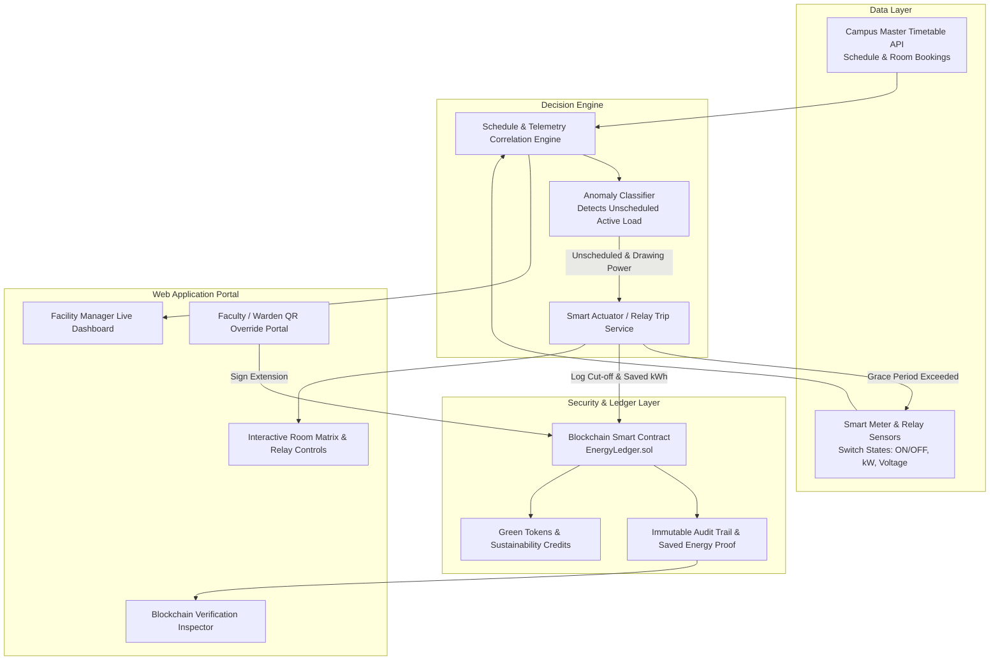

# 💡 Solution Architecture: Timetable-Aware Campus Energy Monitor & Blockchain Ledger

## 1. Overview
The **Campus Energy Monitor & Automated Cut-Off System** is an intelligent, decentralized energy management platform designed to eliminate passive electricity waste across universities. 

By cross-referencing **real-time smart switch/relay power draw** against **campus master timetable schedules**, the system automatically detects rooms drawing electricity when they are scheduled to be empty. If appliances (HVAC, projectors, lights) are left on after classes, the platform enforces an **automated power cut-off** to non-essential circuits, while anchoring all cut-off events, verified energy savings, and manual overrides onto a **tamper-resistant blockchain ledger**.

---

## 2. System Architecture & Workflow

---

## 3. Core Functional Pillars

### 3.1 Timetable-Aware Room Monitoring
* **Continuous Schedule Sync:** Ingests the academic timetable (class slots, lab sessions, seminars, exam schedules).
* **Switch & Power Sensing:** Monitors whether electrical switches/appliances are ON or OFF and measures the aggregate active draw (kW).
* **Cross-Validation Logic:**
  * **Status A (Normal In-Use):** Room scheduled = `ACTIVE`, Switches = `ON` $\rightarrow$ Normal operation.
  * **Status B (Normal Idle):** Room scheduled = `EMPTY`, Switches = `OFF` $\rightarrow$ Safe standby.
  * **Status C (Energy Violation):** Room scheduled = `EMPTY`, Switches = `ON` ($\text{Load} > \text{threshold}$) $\rightarrow$ **Anomaly Flagged!**

---

### 3.2 Automated Smart Power Cut-Off
* **Non-Essential vs. Essential Circuit Separation:**
  * **Essential Circuits (Protected):** Emergency lighting, Wi-Fi routers, safety sensors, server racks, and laboratory refrigeration are never disconnected.
  * **Non-Essential Circuits (Controlled):** High-consumption HVAC units, presentation displays/projectors, and general ambient lighting.
* **Grace Period & Audio/Visual Notification:**
  * When an unscheduled active load is detected, a 5-minute grace period initiates.
  * Notifications are pushed to the room's display panel and faculty/facility managers.
* **Relay Trip Execution:**
  * If no authorized override is submitted before the timer expires, the smart relay trips the non-essential power supply automatically.

---

### 3.3 Authorized Smart Override System
* **Context:** Faculty, researchers, or student project teams may require rooms outside of scheduled hours.
* **Process:**
  * The user scans a room QR code or accesses the web portal.
  * Selects an overtime extension (e.g., 30 mins, 1 hour) and authenticates using their institutional digital identity.
  * Relay remains energized or restores power immediately.
* **Auditability:** The extension request is cryptographically signed and submitted to the blockchain ledger to prevent unauthorized 24/7 power abuse.

---

### 3.4 Blockchain Ledger & Smart Contracts

| Ledger Functionality | Implementation & Smart Contract Action | Purpose |
| :--- | :--- | :--- |
| **Tamper-Proof Audit Trail** | `recordCutoffEvent(roomId, timestamp, savedKWh, eventHash)` | Proves why power was cut off; eliminates disputes over missing lab time or facility accusations. |
| **Proof of Saved Energy** | `mintGreenCredits(departmentId, savedKWh)` | Computes verified savings ($\text{Saved kWh} = \text{Duration} \times \text{Avg kW}$) and mints verifiable green credits for institutional sustainability reports. |
| **Tamper-Proof Overrides** | `logOverride(roomId, userId, duration, signature)` | Creates a permanent log of who kept power on and why, preventing secret facility misuse. |
| **Hourly Batch Verification** | `submitBatchMerkleRoot(timestamp, rootHash)` | Commits cryptographic fingerprints of campus-wide energy usage to prove reports have not been doctored. |

---

## 4. Key Web Application Features

1. **Live Facility Dashboard:**
   * Real-time campus energy draw (kW), total daily consumption (kWh), and grid vs. solar split.
   * Total energy and money saved by automated cut-offs today.

2. **Interactive Room Matrix:**
   * Grid view of campus rooms (*Lecture Hall 101, CS Lab 2, Physics Lab, Seminar Hall*).
   * Visual indicators:
     - 🟢 `Occupied & Scheduled`
     - ⚪ `Empty & Powered Off`
     - 🔴 `Violation: Unscheduled Power Draw`
     - 🔵 `Authorized Override Active`
   * Real-time relay status toggle and manual emergency bypass.

3. **Live "Cut-Off Simulation" Demonstration Mode (For Judges):**
   * A 1-click presentation tool:
     1. Click *"Simulate Class Ending at 11:00 AM"*.
     2. Watch room state turn to violation.
     3. 5-second accelerated grace countdown begins.
     4. Power automatically cuts off.
     5. Saved kWh counter increments.
     6. Blockchain transaction receipt populates with block number and transaction hash.

4. **Blockchain Audit Explorer & Tamper Detector:**
   * Built-in block explorer showing transactions, hashes, and Merkle proofs.
   * **"Simulate Database Tamper" button:** Alters an off-chain record to immediately trigger a cryptographic hash mismatch alert, showing the value of blockchain integrity in action.

---

## 5. Summary of Benefits & Hackathon Strengths

* **Action-Oriented:** Eliminates wasted electricity proactively rather than passively waiting for monthly utility bills.
* **Economically & Environmentally Justified:** Reduces campus electricity bills by an estimated 15%–30% and curbs carbon emissions.
* **Practical Blockchain Integration:** Solves genuine trust, auditability, and governance problems without being an unnecessary gimmick.
* **Compelling Interactive Demo:** Engaging visual elements (room status matrix, live cut-off triggers, tamper simulation) that captivate hackathon evaluators.
